# GymRat

**Anatomi otot 3D & biomekanika gerakan gym — alat edukasi berbahasa Indonesia (dan Inggris).**
100% di sisi klien: tanpa backend, tanpa akun, tanpa pelacakan, bisa dipakai offline setelah dimuat.

> _English summary:_ GymRat is a client-side 3D educational web app about muscle anatomy and the
> biomechanics of gym movements. Indonesian by default, with a full English toggle. No backend, no
> accounts, no tracking; works offline after the first load.

> ⚠️ **Alat edukasi — bukan pengganti pelatih bersertifikat, dokter, atau fisioterapis.**

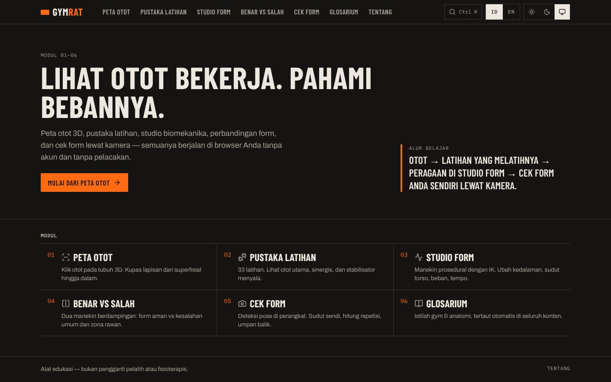

## Daftar isi

1. [Ringkasan fitur](#ringkasan-fitur)
2. [Galeri tampilan](#galeri-tampilan)
   - [Beranda, navigasi, pencarian, bahasa & tema](#1-beranda-navigasi-pencarian-bahasa--tema)
   - [Modul 01 — Peta Otot](#2-modul-01--peta-otot)
   - [Modul 02 — Pustaka Latihan](#3-modul-02--pustaka-latihan)
   - [Modul 03 — Studio Form](#4-modul-03--studio-form)
   - [Modul 04 — Benar vs Salah](#5-modul-04--benar-vs-salah)
   - [Modul 05 — Cek Form Webcam](#6-modul-05--cek-form-webcam)
   - [Modul 06 & 07 — Glosarium dan Tentang](#7-modul-06--07--glosarium-dan-tentang)
3. [Cara memakai (alur belajar)](#cara-memakai-alur-belajar)
4. [Menjalankan secara lokal](#menjalankan-secara-lokal)
5. [Tech stack](#tech-stack)
6. [Struktur proyek](#struktur-proyek)
7. [Bahasa & tema](#bahasa--tema)
8. [Model 3D & cara mengganti ke glTF](#model-3d--cara-mengganti-ke-gltf)
9. [Model biomekanika & batasannya](#model-biomekanika--batasannya)
10. [Privasi](#privasi)
11. [Offline](#offline)
12. [Pengujian](#pengujian)
13. [Deploy ke GitHub Pages](#deploy-ke-github-pages)
14. [Data “perlu verifikasi”](#data-perlu-verifikasi)
15. [Lisensi](#lisensi)

## Ringkasan fitur

| #   | Modul               | Isi                                                                                                                                                                             |
| --- | ------------------- | ------------------------------------------------------------------------------------------------------------------------------------------------------------------------------- |
| 01  | **Peta Otot**       | Tubuh 3D prosedural dengan 34 otot yang bisa diklik: nama ID/EN + Latin, origo, insersio, fungsi, latihan terkait. Lapisan superfisial → tengah → dalam, tampak depan/belakang. |
| 02  | **Pustaka Latihan** | 33 latihan. Otot utama, sinergis, dan stabilisator menyala dengan skala intensitas. Filter per otot & alat.                                                                     |
| 03  | **Studio Form**     | Manekin prosedural (tulang + IK, tanpa file animasi) untuk back squat, deadlift, lunge, overhead press. Slider parameter + grafik momen sendi real-time.                        |
| 04  | **Benar vs Salah**  | Dua manekin berdampingan untuk 4 kesalahan umum, lengkap dengan zona rawan cedera dan cara memperbaiki.                                                                         |
| 05  | **Cek Form Webcam** | Deteksi pose di browser (MediaPipe): sudut sendi, hitung repetisi, umpan balik. Video tidak pernah dikirim ke mana pun.                                                         |
| 06  | **Glosarium**       | 34 istilah gym & anatomi, ditautkan otomatis di seluruh konten (ID & EN).                                                                                                       |
| 07  | **Tentang**         | Disclaimer, prinsip, batasan model, sumber, lisensi aset, daftar data “perlu verifikasi”.                                                                                       |

Fitur lintas modul: navigasi kontekstual (otot → latihan → Studio Form → webcam), pencarian global
**Ctrl/⌘ + K**, toggle bahasa **ID/EN**, tema **Terang / Gelap / Ikuti sistem**, desain mobile-first,
navigasi keyboard, dan dukungan `prefers-reduced-motion`.

---

## Galeri tampilan

Semua screenshot diambil dari build produksi (`npm run build`) dengan Chromium. Tampilan desktop berukuran
1440 × 900, tampilan HP memakai emulasi Pixel 7. File aslinya ada di [`docs/screenshots/`](docs/screenshots/).

### 1. Beranda, navigasi, pencarian, bahasa & tema

#### Beranda — tema gelap (desktop)


**Menampilkan:** judul aplikasi, ringkasan singkat, tombol **Mulai dari Peta Otot**, kotak **Alur belajar**
(otot → latihan → Studio Form → kamera), dan grid enam modul bernomor 01–06 beserta deskripsinya.
Di header ada menu utama, tombol pencarian (**Ctrl K**), toggle bahasa **ID/EN**, dan tiga tombol tema
(terang ☀, gelap ☾, ikuti sistem 🖥).
**Untuk apa:** titik masuk — pengguna langsung tahu ada modul apa saja dan urutan belajar yang disarankan.

#### Beranda — tema terang di HP

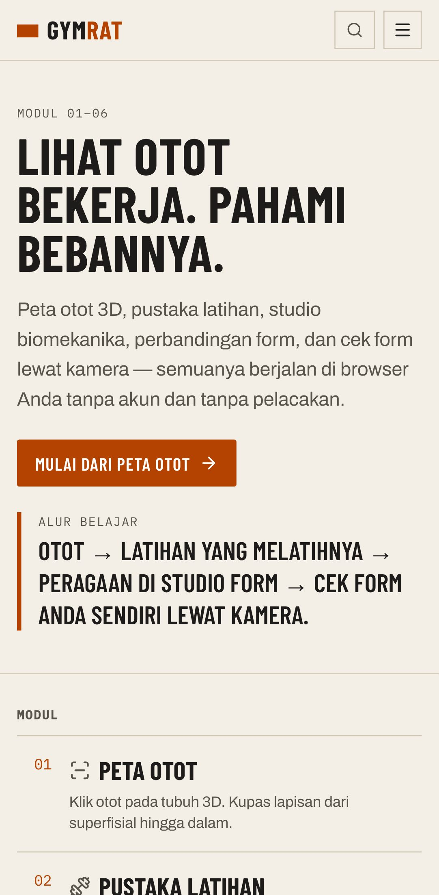

**Menampilkan:** tata letak mobile-first. Header diringkas menjadi logo, tombol cari, dan tombol menu.
Tema terang memakai latar off-white hangat dengan teks arang dan aksen oranye yang lebih gelap — bukan
sekadar kebalikan tema gelap — agar kontras teks tetap memenuhi WCAG AA.
**Untuk apa:** target utama aplikasi adalah HP; semua modul dirancang untuk layar sempit terlebih dahulu.

#### Menu navigasi di HP

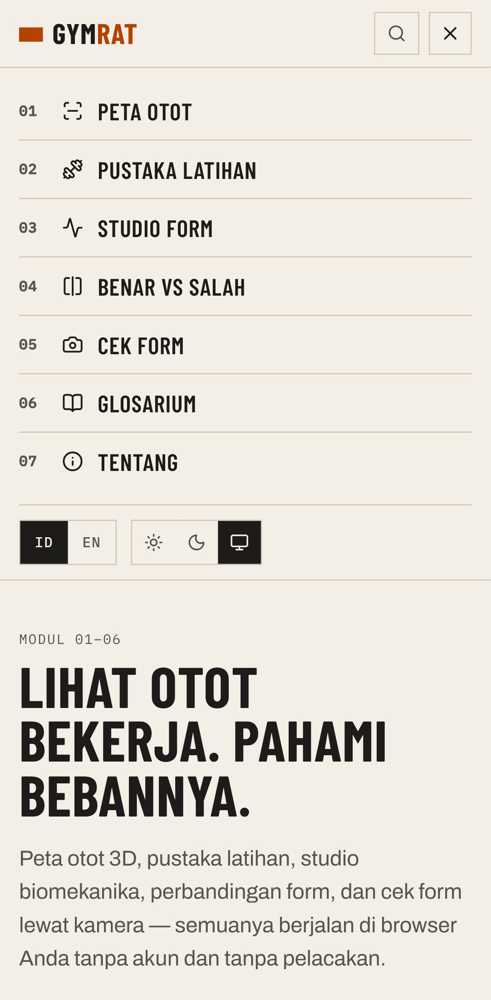

**Menampilkan:** menu yang terbuka dari tombol ☰: tujuh modul bernomor dengan ikon, lalu toggle bahasa
dan tema di bagian bawah (pada HP kontrol ini dipindahkan ke dalam menu supaya header tetap lega).
**Untuk apa:** berpindah modul dengan target sentuh besar (≥ 44 px).

#### Pencarian global (Ctrl/⌘ + K)

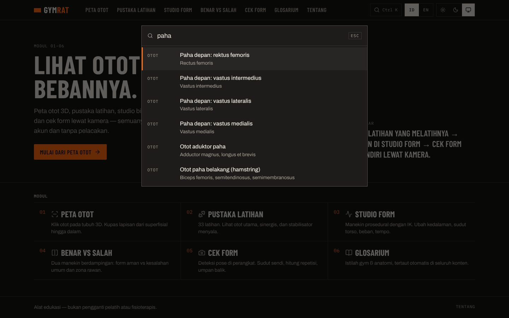

**Menampilkan:** dialog pencarian dengan kueri “paha”. Hasil dikelompokkan per jenis (**Otot**, **Latihan**,
**Istilah**, **Halaman**), dengan nama Latin/ringkasan sebagai subjudul. Panah atas/bawah memilih hasil,
**Enter** membuka, **Esc** menutup.
**Untuk apa:** langsung melompat ke otot, latihan, atau istilah mana pun. Pencarian bersifat dwibahasa —
mengetik “hamstrings” saat bahasa Indonesia aktif (atau “paha belakang” saat bahasa Inggris aktif) tetap
menemukan otot yang sama, begitu juga nama Latin.

#### Bahasa Inggris (toggle EN)

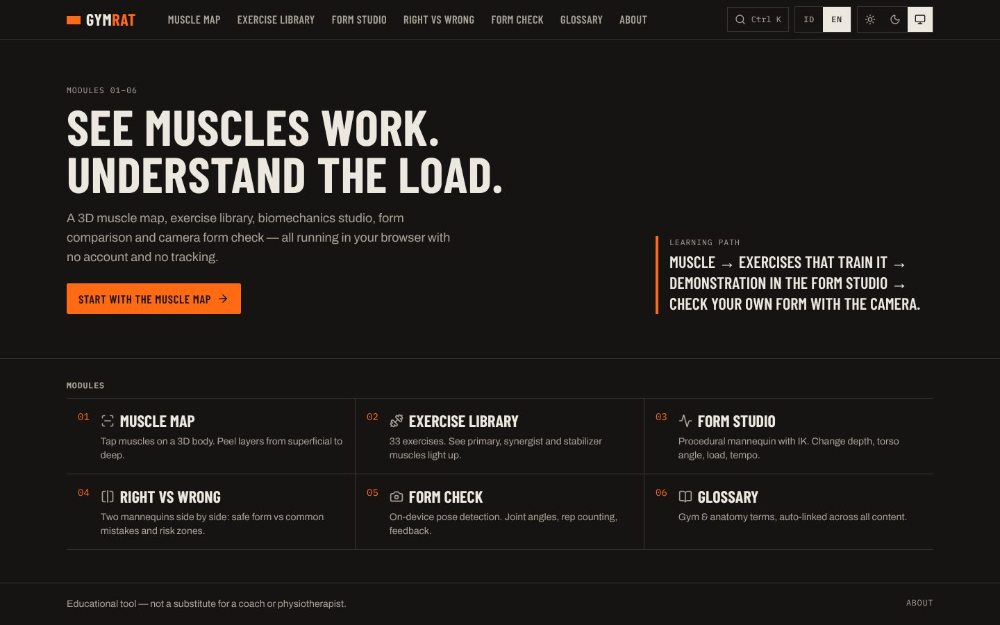

**Menampilkan:** seluruh antarmuka setelah toggle **EN** ditekan — judul, deskripsi modul, menu.
Pilihan bahasa disimpan di perangkat dan diterapkan ke atribut `lang` halaman.
**Untuk apa:** semua teks UI dan seluruh konten ilmiah (otot, latihan, glosarium, kesalahan form,
disclaimer) tersedia dalam dua bahasa.

---

### 2. Modul 01 — Peta Otot

#### Tampak depan (default)

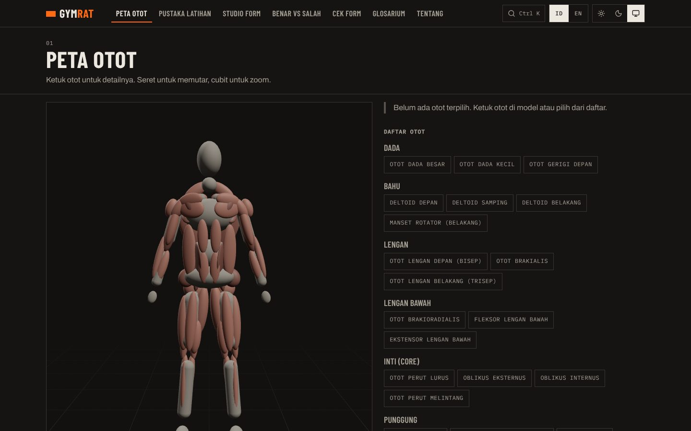

**Menampilkan:** tubuh 3D prosedural tampak depan dengan semua otot lapisan superfisial. Di bawah kanvas ada
kontrol **Sisi** (Depan / Belakang) dan **Lapisan** (Superfisial / Tengah / Dalam). Panel kanan berisi
**Daftar otot** dikelompokkan per regio (dada, bahu, lengan, lengan bawah, inti, punggung, pinggul, paha,
tungkai bawah).
**Untuk apa:** menjelajahi otot. Ketuk/klik otot di model (atau tombol di daftar) untuk membuka detail.
Seret untuk memutar, cubit/scroll untuk zoom. Mengarahkan kursor ke otot menyorotnya dan menampilkan namanya.

#### Tampak belakang

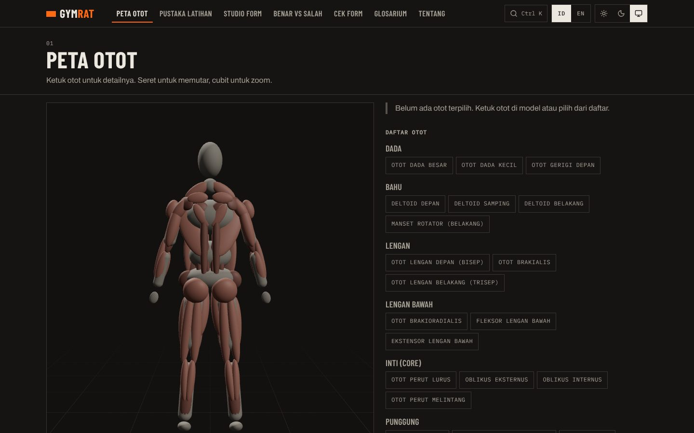

**Menampilkan:** kamera berputar mulus ke sisi belakang: trapesius, deltoid belakang, lat, penegak tulang
belakang, bokong, hamstring, betis.
**Untuk apa:** melihat otot-otot punggung dan rantai posterior.

#### Lapisan tengah

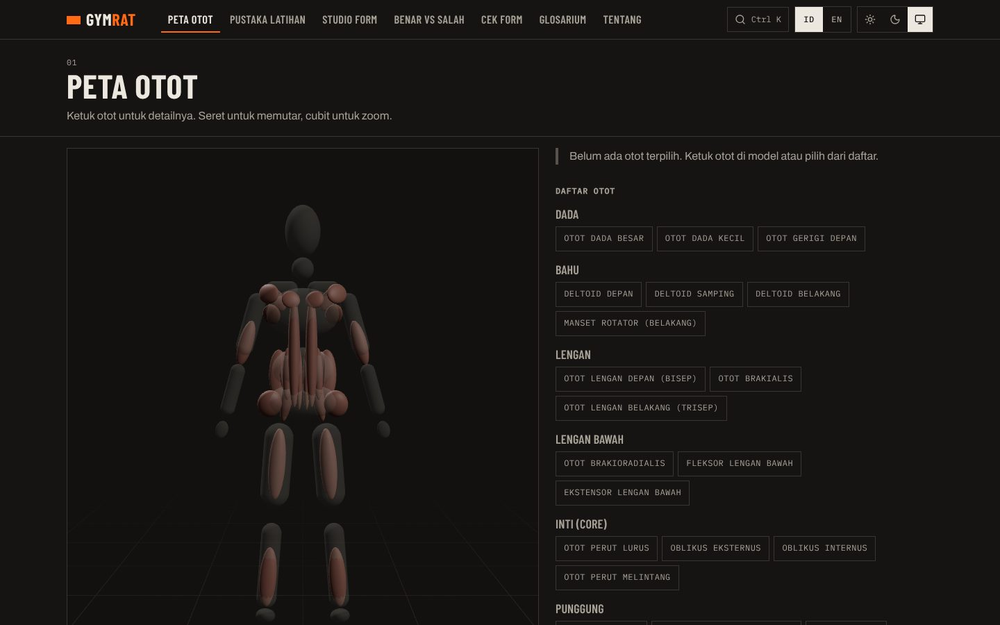

**Menampilkan:** otot superfisial “dikupas”; yang tersisa adalah otot lapisan 2 dan 3 (mis. romboid, penegak
tulang belakang, bokong tengah, soleus, brakialis). Badan manekin dibuat tembus pandang agar otot yang
lebih dalam terlihat.
**Untuk apa:** memahami otot yang tertutup otot lain.

#### Lapisan dalam

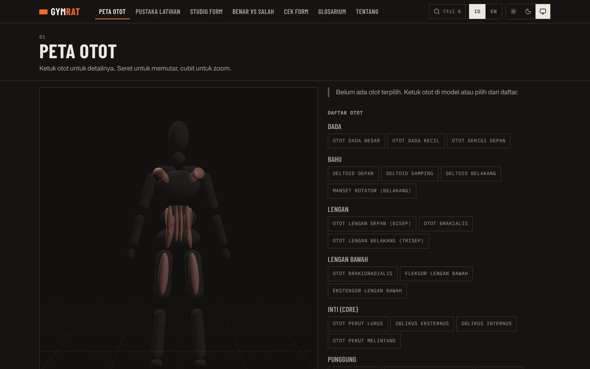

**Menampilkan:** hanya otot lapisan 3: multifidus, kuadratus lumborum, manset rotator, vastus intermedius,
iliopsoas, otot perut melintang, otot dada kecil.
**Untuk apa:** melihat otot stabilisator dalam yang sering disebut dalam konteks “core” dan stabilitas sendi.

#### Otot terpilih — detail (tema terang)

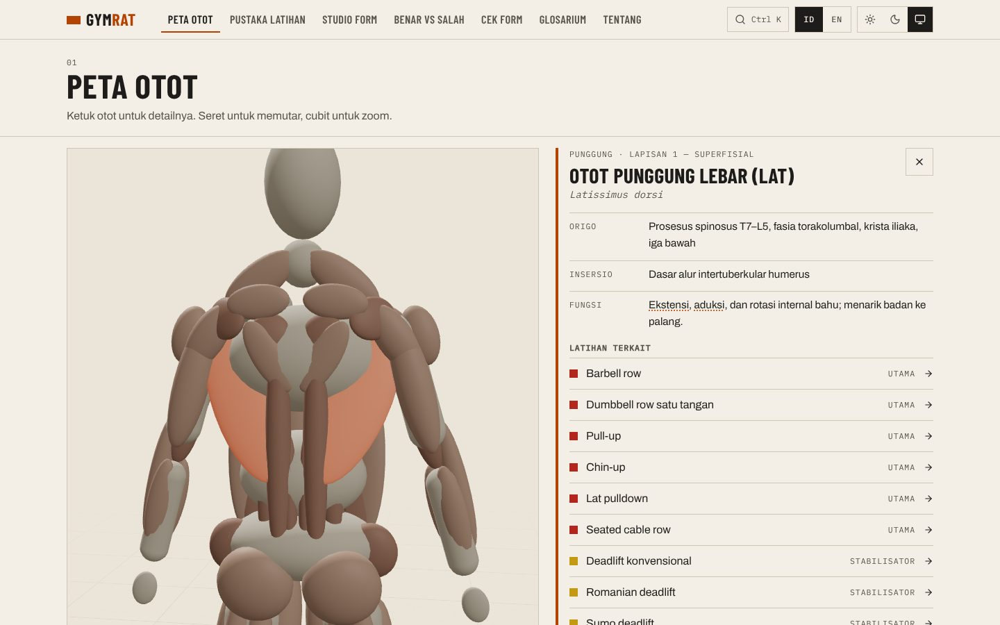

**Menampilkan:** otot **Lat (Latissimus dorsi)** terpilih: disorot oranye di model, kamera mendekat ke otot.
Panel detail berisi regio dan lapisan, nama Indonesia + nama Latin, **Origo**, **Insersio**, **Fungsi**
(istilah glosarium bergaris titik dan bisa diklik, mis. “ekstensi”, “aduksi”), lalu **Latihan terkait**
dengan kotak warna perannya (utama / sinergis / stabilisator) dan tombol **Lihat di Pustaka Latihan**.
**Untuk apa:** belajar anatomi satu otot lalu langsung menuju latihan yang melatihnya. URL-nya bisa
dibagikan, mis. `#/otot/latissimus-dorsi`.

#### Peta Otot di HP

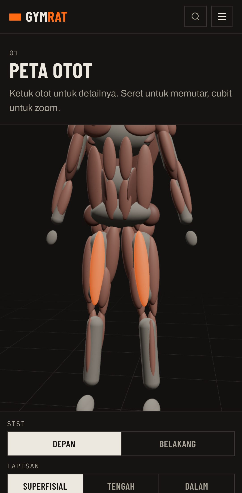

**Menampilkan:** tata letak HP: kanvas 3D di atas, kontrol sisi & lapisan di bawahnya, lalu panel detail
(di sini **Paha depan: rektus femoris**).
**Untuk apa:** pengalaman yang sama di layar sempit; jarak kamera otomatis disesuaikan.

---

### 3. Modul 02 — Pustaka Latihan

#### Daftar dengan filter otot & alat

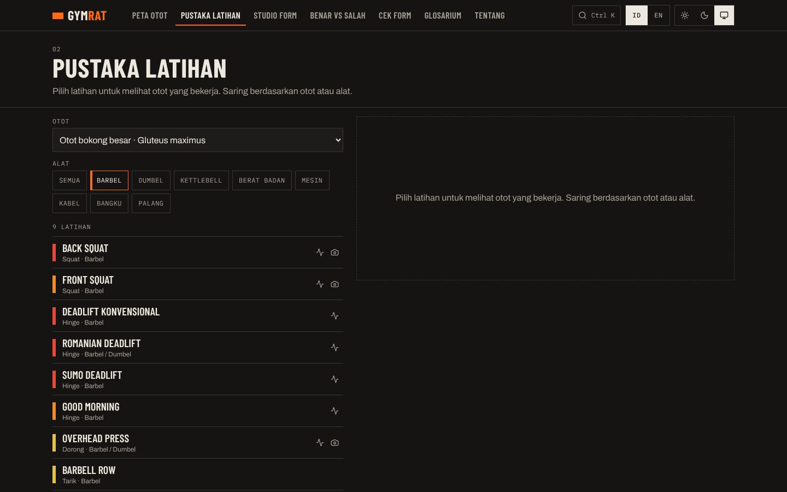

**Menampilkan:** filter **Otot** = “Otot bokong besar · Gluteus maximus” dan **Alat** = “Barbel”, dengan
jumlah hasil (9 latihan). Garis warna di kiri tiap latihan menunjukkan peran otot yang difilter dalam
latihan itu (merah = utama, oranye = sinergis, kuning = stabilisator). Ikon di kanan menandai latihan yang
punya peragaan di Studio Form (〜) dan/atau bisa dicek dengan kamera (📷).
**Untuk apa:** mencari latihan untuk otot tertentu dengan alat yang tersedia. Filter tersimpan di URL
(`#/latihan?otot=gluteus-maximus&alat=barbell`) sehingga bisa dibagikan.

#### Detail latihan — Back squat

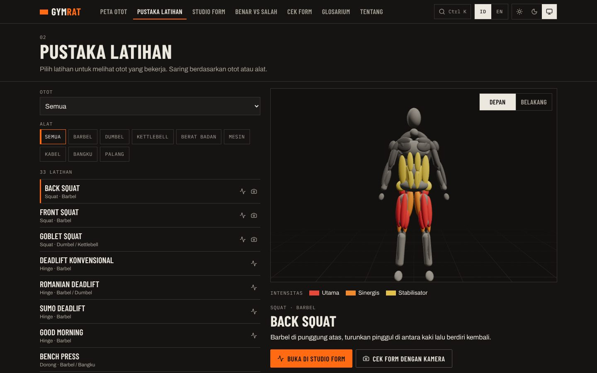

**Menampilkan:** model 3D dengan otot yang bekerja menyala sesuai **intensitas** (legenda: Utama, Sinergis,
Stabilisator; otot lain diredupkan). Di bawahnya: pola gerak & alat, ringkasan, tombol **Buka di Studio Form**
dan **Cek form dengan kamera**, tiga kolom otot per peran (bisa diklik ke Peta Otot), **Isyarat teknik**
bernomor, dan **Kesalahan umum** yang menaut ke modul Benar vs Salah.
**Untuk apa:** memahami otot apa saja yang bekerja dan seberapa besar perannya, lalu lanjut ke peragaan
atau pengecekan form.

#### Detail latihan — Deadlift, tampak belakang (tema terang)

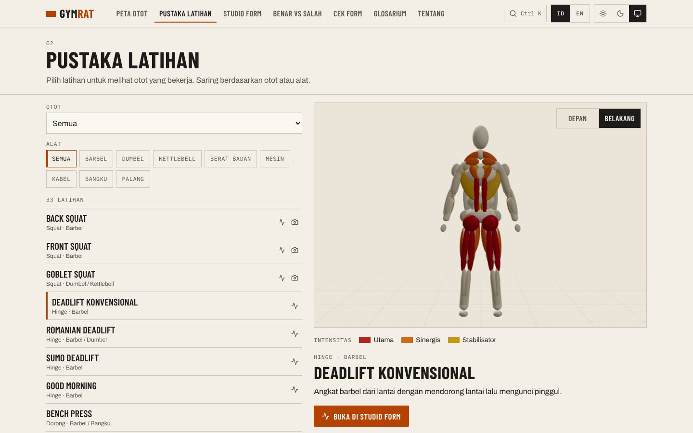

**Menampilkan:** toggle **Depan/Belakang** di pojok kanan atas kanvas. Untuk deadlift, otot utama ada di
belakang (bokong, hamstring, penegak tulang belakang) sehingga sisi belakang dipilih otomatis.
Skala intensitas di tema terang memakai tingkat warna yang disesuaikan agar tetap terbaca.
**Untuk apa:** melihat otot di sisi tubuh mana pun; sisi default otomatis mengikuti letak otot utama.

#### Detail latihan dalam bahasa Inggris

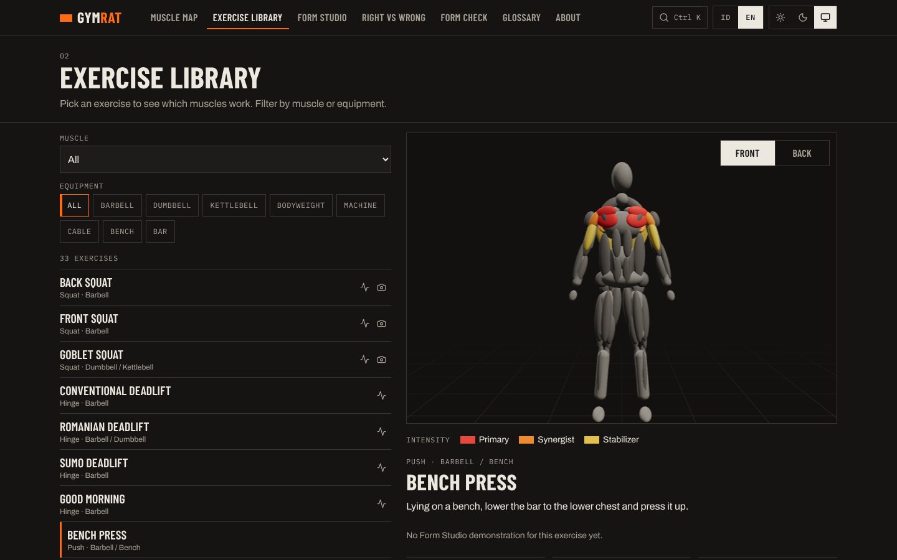

**Menampilkan:** Exercise Library dalam bahasa Inggris dengan **Bench press** terpilih: label filter
(“Muscle”, “Equipment”), nama pola & alat (“Push · Barbell / Bench”), legenda intensitas
(Primary / Synergist / Stabilizer), dan catatan bahwa latihan ini belum punya peragaan di Form Studio.
Di model, dada dan trisep menyala sebagai otot utama, deltoid depan sebagai sinergis.
**Untuk apa:** menunjukkan konten ilmiah juga dwibahasa, bukan hanya label antarmuka.

---

### 4. Modul 03 — Studio Form

Studio Form memperagakan gerakan memakai manekin prosedural: posisi tiap sendi dihitung lewat
**inverse kinematics** (IK) dua-tulang dan aturan keseimbangan (barbel di atas tengah telapak kaki), bukan
dari file animasi. Grafik di kanan menunjukkan **momen sendi** (kecenderungan beban memutar sendi, N·m)
sebagai estimasi edukatif.

#### Back squat — posisi bawah

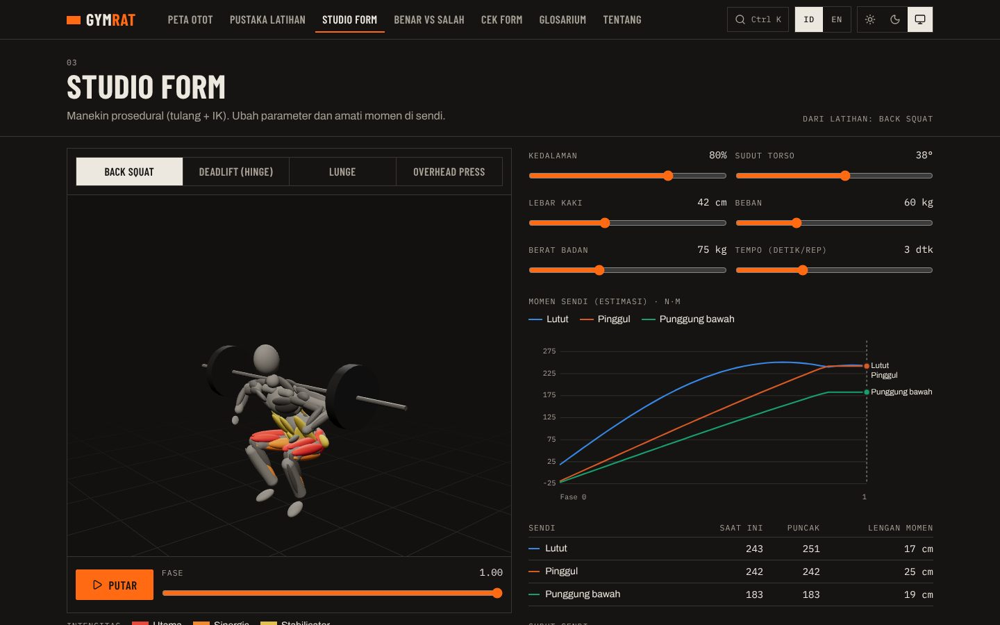

**Menampilkan:**

- **Pemilih gerakan**: Back squat / Deadlift (hinge) / Lunge / Overhead press.
- **Kanvas 3D**: manekin, barbel, dan otot yang bekerja menyala; bisa diputar & di-zoom.
- **Putar/Jeda** dan **slider Fase** (0 = atas, 1 = paling bawah) untuk menghentikan gerakan di titik mana pun.
- **Slider parameter**: Kedalaman, Sudut torso, Lebar kaki, Beban, Berat badan, Tempo (detik per repetisi).
- **Grafik momen sendi**: lutut (biru), pinggul (oranye), punggung bawah (hijau) terhadap fase; garis putus-putus
  menandai posisi saat ini.
- **Tabel nilai**: momen saat ini, puncak, dan lengan momen per sendi; lalu **Sudut sendi** (lutut, pinggul, torso).

**Untuk apa:** bereksperimen — misalnya menambah kedalaman atau beban dan melihat bagaimana beban di tiap sendi berubah.

#### Grafik dengan tooltip

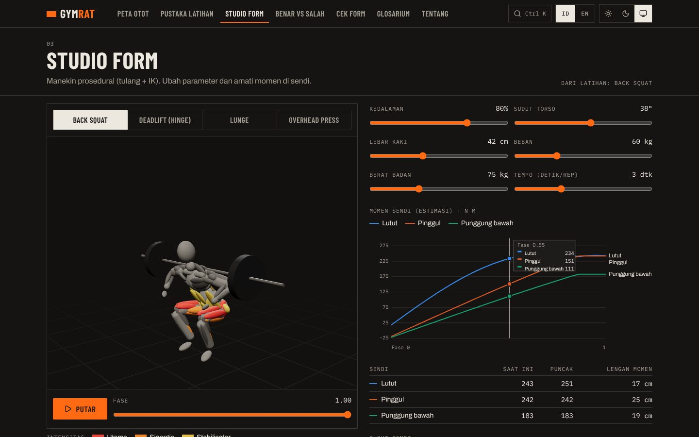

**Menampilkan:** saat kursor (atau jari) berada di atas grafik, garis vertikal mengikuti posisi dan tooltip
menampilkan nilai ketiga sendi pada fase tersebut. Label nama sendi juga ditulis langsung di ujung garis.
**Untuk apa:** membaca angka tepat di titik mana pun. Warna grafik diuji aman untuk buta warna di kedua tema,
dan identitas garis tidak hanya bergantung pada warna (ada label dan tabel).

#### Peringatan batas mobilitas

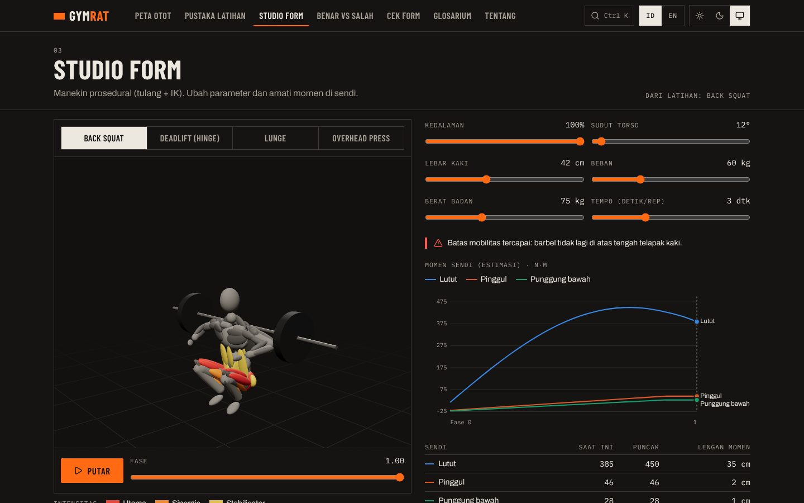

**Menampilkan:** sudut torso diturunkan ke 12° (sangat tegak) dengan kedalaman 100%. Agar barbel tetap di
atas tengah telapak, lutut harus maju melebihi batas dorsofleksi pergelangan kaki, sehingga muncul peringatan
**“Batas mobilitas tercapai”**. Grafik memperlihatkan beban bergeser hampir seluruhnya ke lutut.
**Untuk apa:** menunjukkan hubungan sudut torso ↔ beban lutut/pinggul, dan bahwa tidak semua kombinasi
parameter realistis.

#### Deadlift (hinge)

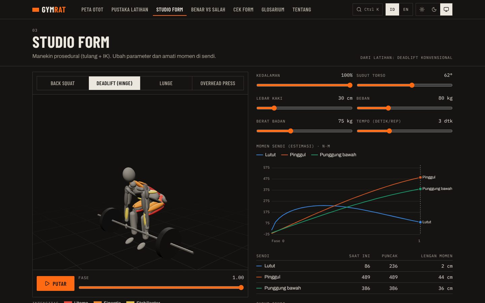

**Menampilkan:** posisi bawah deadlift dengan barbel di lantai dan lengan menggantung vertikal. Momen pinggul
dan punggung bawah dominan, momen lutut kecil di posisi bawah.
**Untuk apa:** membandingkan pola hinge dengan squat; slider sudut torso mengubah seberapa membungkuk badan.

#### Lunge

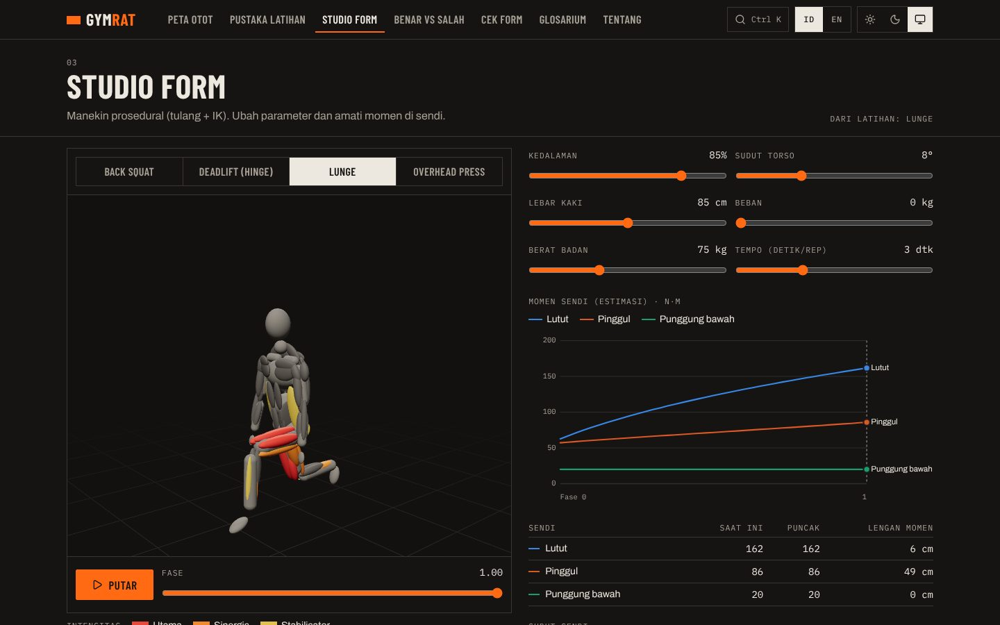

**Menampilkan:** lunge dengan lutut belakang mendekati lantai; slider **Lebar kaki** di sini menjadi panjang
langkah. Untuk lunge, momen dihitung dengan metode gaya reaksi lantai (diasumsikan 80% beban di kaki depan).
**Untuk apa:** melihat beban kaki depan dan pengaruh panjang langkah serta kemiringan torso.

#### Overhead press

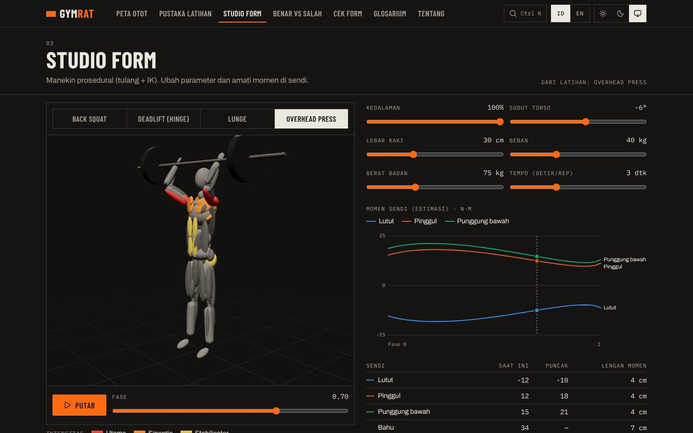

**Menampilkan:** barbel ditekan dari bahu ke atas kepala (lengan memakai IK). Tabel menambahkan baris
**Bahu**, karena di gerakan ini beban terbesar ada di bahu; slider sudut torso negatif = condong ke belakang.
**Untuk apa:** melihat bahwa condong ke belakang menambah momen punggung bawah.

#### Studio Form — tema terang

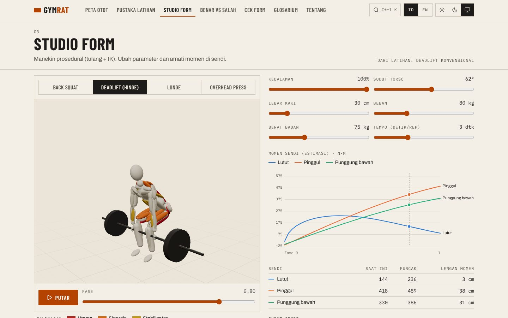

**Menampilkan:** studio dengan tema terang: latar scene, cahaya, warna manekin, grid lantai, dan grafik
memakai preset terang.
**Untuk apa:** scene 3D dan grafik ikut tema, bukan hanya halaman di sekitarnya.

#### Studio Form di HP

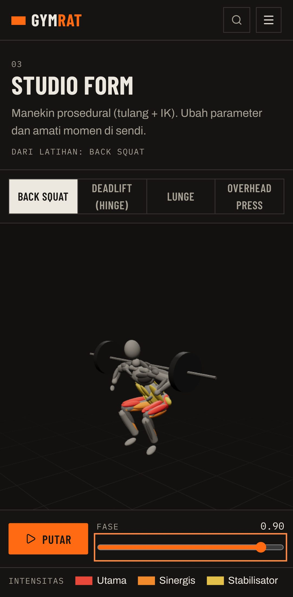

**Menampilkan:** di HP, kanvas dan kontrol putar/fase berada di atas; slider, grafik, dan tabel menyusul di bawah.
**Untuk apa:** studio tetap bisa dipakai penuh di layar sempit. Bila `prefers-reduced-motion` aktif, animasi
berhenti otomatis dan fase diatur manual lewat slider.

---

### 5. Modul 04 — Benar vs Salah

Dua manekin bergerak serempak: kiri (**Benar**, label hijau) memakai form yang dianjurkan, kanan
(**Salah**, label merah) memperagakan kesalahannya. Bola merah berdenyut menandai **zona rawan** — area yang
menerima beban berlebih.

#### Lutut masuk (knee valgus) — tampak depan

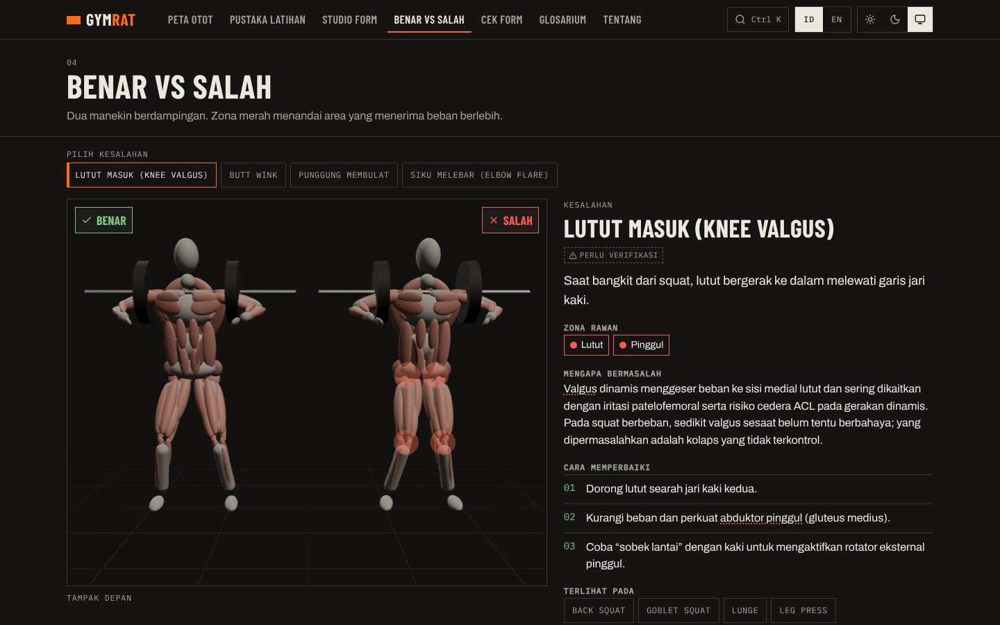

**Menampilkan:** squat tampak depan; pada manekin kanan lutut bergerak ke dalam melewati garis jari kaki,
dengan zona rawan di lutut dan pinggul. Panel kanan: ringkasan, **Zona rawan**, **Mengapa bermasalah**,
**Cara memperbaiki** (bernomor), dan **Terlihat pada** (latihan terkait).
**Untuk apa:** mengenali valgus dinamis dan cara memperbaikinya.

#### Butt wink — tampak samping

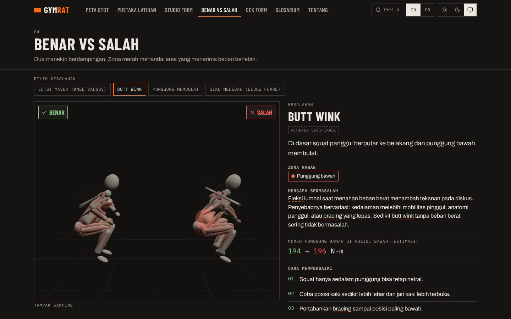

**Menampilkan:** squat dalam tampak samping; pada manekin kanan panggul berputar ke belakang di posisi bawah
sehingga punggung bawah membulat. Ditambah perbandingan **momen punggung bawah** (estimasi) benar → salah.
**Untuk apa:** memahami penyebab butt wink dan kapan perlu dikhawatirkan.

#### Punggung membulat — tampak samping

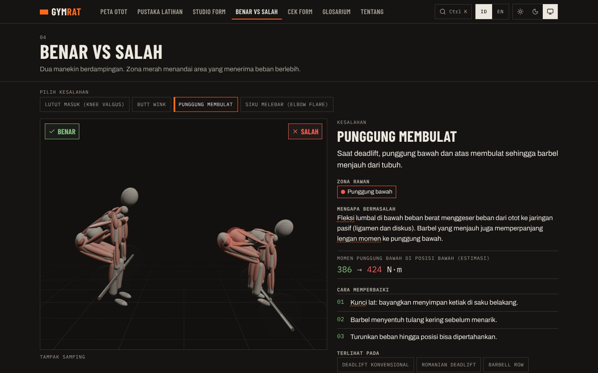

**Menampilkan:** deadlift dengan punggung netral vs membulat. Pada versi salah, bahu dan barbel maju sehingga
lengan momen ke punggung bawah bertambah; angka momen punggung bawah naik (mis. 386 → 424 N·m).
**Untuk apa:** menunjukkan secara kuantitatif mengapa punggung membulat menambah beban di punggung bawah.

#### Siku melebar (elbow flare) — tampak atas

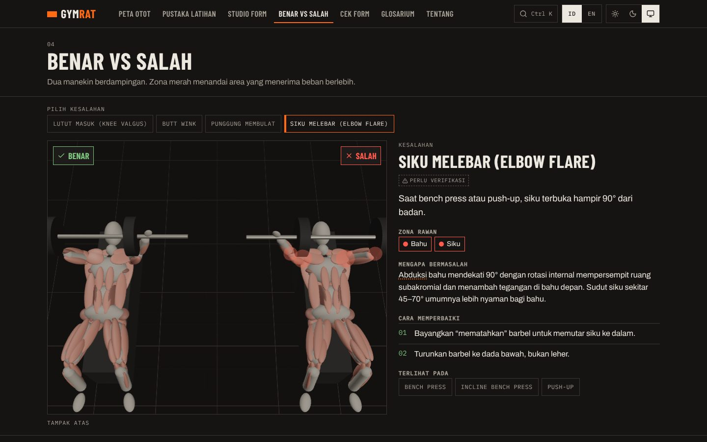

**Menampilkan:** bench press dilihat dari atas; manekin kiri dengan siku sekitar 45–70° dari badan, manekin
kanan dengan siku mendekati 90°. Zona rawan di bahu dan siku.
**Untuk apa:** melihat sudut siku yang lebih ramah untuk bahu.

#### Benar vs Salah di HP

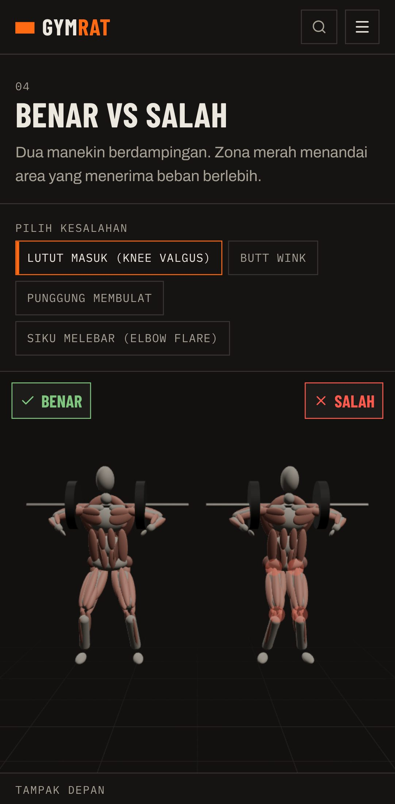

**Menampilkan:** pemilih kesalahan berupa chip di atas, kanvas dengan label Benar/Salah, lalu penjelasan di bawah.
**Untuk apa:** modul yang sama di layar sempit.

---

### 6. Modul 05 — Cek Form Webcam

#### Sebelum kamera dinyalakan

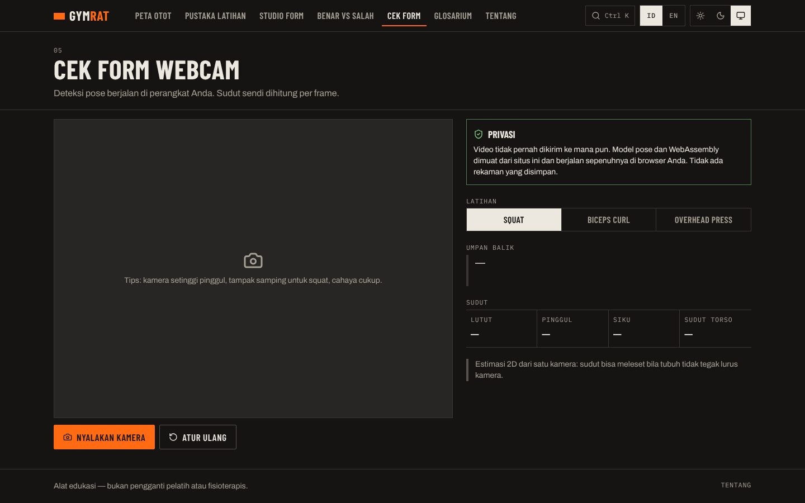

**Menampilkan:** area kamera dengan tips posisi, tombol **Nyalakan kamera** dan **Atur ulang**, kotak
**Privasi** (video tidak pernah dikirim ke mana pun), pemilih **Latihan** (Squat / Biceps curl / Overhead
press), kotak **Umpan balik**, tabel **Sudut** (lutut, pinggul, siku, torso), dan catatan batasan estimasi 2D.
**Untuk apa:** menjelaskan apa yang akan terjadi dan menjamin privasi _sebelum_ izin kamera diminta.
Model pose baru diunduh (dari situs ini sendiri) saat tombol ditekan.

#### Saat kamera berjalan

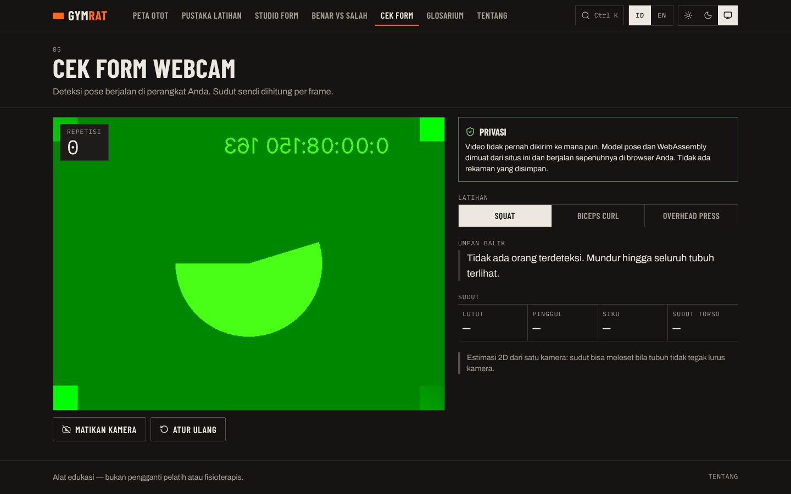

**Menampilkan:** video kamera (dicerminkan seperti kamera selfie) dengan penghitung **Repetisi** di pojok;
saat ada orang, kerangka pose digambar di atas video dan sudut sendi diperbarui terus. Tombol berganti
menjadi **Matikan kamera**.
**Catatan screenshot:** gambar ini diambil di lingkungan otomatis dengan **kamera palsu** milik Chromium (pola
uji hijau), sehingga tidak ada orang yang terdeteksi dan umpan balik berbunyi “Tidak ada orang terdeteksi”.
Dengan kamera sungguhan, kerangka oranye, sudut, hitungan repetisi, dan umpan balik (mis. “Turun lebih dalam”,
“Lutut masuk ke dalam”) muncul secara langsung.
**Untuk apa:** mengecek form sendiri; repetisi dihitung dengan histeresis supaya goyangan kecil tidak terhitung.

---

### 7. Modul 06 & 07 — Glosarium dan Tentang

#### Glosarium

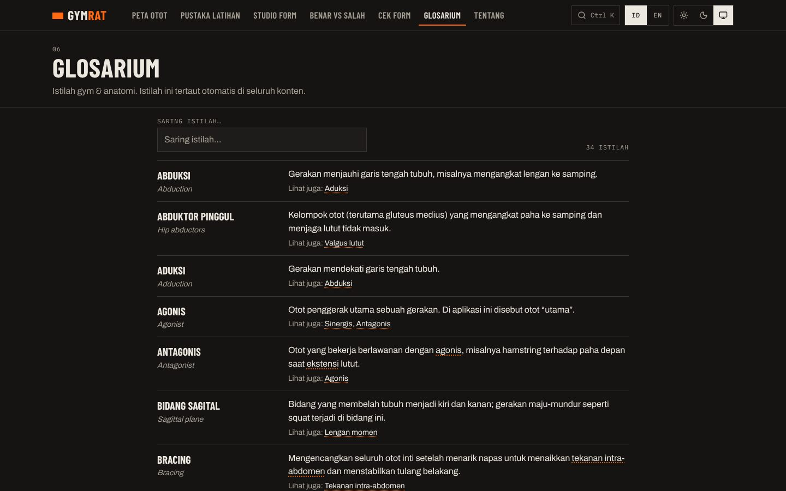

**Menampilkan:** 34 istilah urut abjad (sesuai bahasa aktif), masing-masing dengan padanan di bahasa lain,
definisi, dan tautan **Lihat juga**. Kotak **Saring istilah** di atas menyaring daftar secara langsung.
**Untuk apa:** referensi istilah. Istilah yang sama otomatis menjadi tautan bergaris titik di halaman lain
(detail otot, latihan, kesalahan form, Tentang).

#### Istilah yang dibuka dari tautan

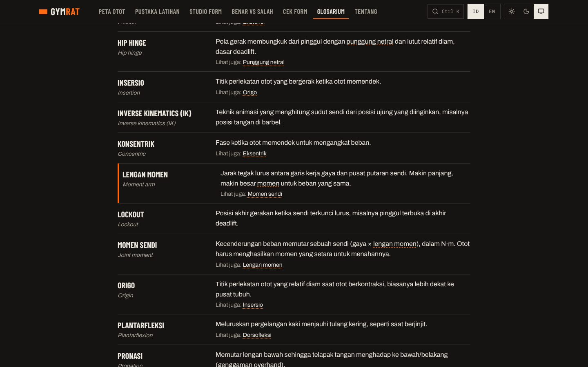

**Menampilkan:** membuka `#/glosarium/moment-arm` (mis. dengan mengeklik “lengan momen” di halaman Benar vs
Salah) menggulir ke istilah **Lengan momen** dan menandainya dengan garis oranye.
**Untuk apa:** dari konten mana pun, satu klik untuk memahami istilah teknis.

#### Tentang

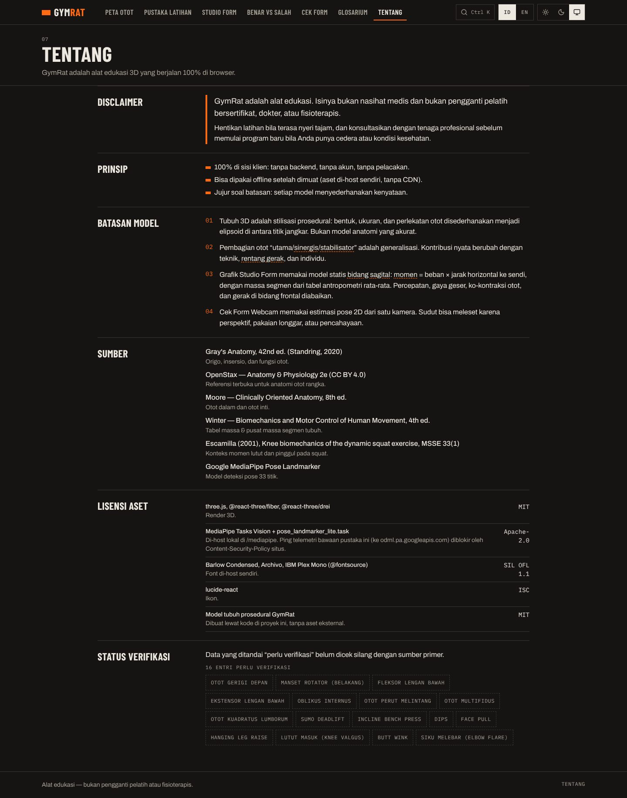

**Menampilkan (satu halaman penuh):** **Disclaimer**, **Prinsip** (100% klien, offline, jujur soal batasan),
**Batasan model** (stilisasi tubuh, generalisasi peran otot, model biomekanika statis, estimasi pose 2D),
**Sumber** (Gray's Anatomy, OpenStax, Moore, Winter, Escamilla, MediaPipe), **Lisensi aset**, dan
**Status verifikasi** — daftar entri yang masih “perlu verifikasi”, masing-masing menaut ke halamannya.
**Untuk apa:** transparansi tentang dari mana data berasal, apa yang disederhanakan, dan apa yang belum dicek.

---

## Cara memakai (alur belajar)

1. **Peta Otot** — pilih otot (mis. _Otot bokong besar_), baca origo/insersio/fungsinya.
2. Klik salah satu **Latihan terkait** → **Pustaka Latihan** menunjukkan semua otot yang bekerja pada latihan itu.
3. Klik **Buka di Studio Form** → atur kedalaman, sudut torso, beban, lalu amati grafik momen sendi.
4. Bila latihan punya **Kesalahan umum**, buka **Benar vs Salah** untuk melihat versi salahnya dan zona rawannya.
5. Klik **Cek form dengan kamera** → nyalakan kamera dan lakukan gerakan; GymRat menghitung repetisi dan memberi umpan balik.
6. Istilah yang belum dipahami? Klik kata bergaris titik atau tekan **Ctrl/⌘ + K**.

## Menjalankan secara lokal

```bash
npm install        # juga menyalin WASM MediaPipe & decoder Draco ke public/ (scripts/copy-assets.mjs)
npm run dev        # http://localhost:5173/GymRat/
npm test           # unit test (Vitest)
npm run e2e        # smoke test Playwright (build + preview otomatis)
npm run lint       # ESLint
npm run typecheck  # TypeScript strict
npm run build      # hasil di dist/
npm run preview    # menyajikan dist/ di http://localhost:4173/GymRat/
```

Butuh **Node 20+**. Bila Chromium sudah terpasang di mesin, `PW_CHROMIUM_PATH=/path/ke/chrome npm run e2e`
melewati `npx playwright install`. Fitur webcam butuh konteks aman (HTTPS atau `localhost`).

## Tech stack

| Bagian          | Teknologi                                                                       |
| --------------- | ------------------------------------------------------------------------------- |
| Build & bahasa  | Vite, React 19, TypeScript strict (tanpa `any`)                                 |
| 3D              | three.js via @react-three/fiber, @react-three/drei, @react-three/postprocessing |
| Gaya            | Tailwind CSS v4 + design tokens di CSS variables                                |
| State & routing | Zustand, React Router (HashRouter)                                              |
| Validasi konten | Zod                                                                             |
| Bahasa          | i18next + react-i18next                                                         |
| Deteksi pose    | @mediapipe/tasks-vision (WASM & model di-host lokal)                            |
| Ikon & font     | lucide-react; @fontsource Barlow Condensed, Archivo, IBM Plex Mono              |
| Kualitas        | Vitest, Playwright, ESLint, Prettier                                            |

## Struktur proyek

```
src/content   data otot, latihan, glosarium, kesalahan form, Tentang — dwibahasa {id, en}, divalidasi Zod
src/lib       logika murni & teruji: rig (FK), IK, gerakan, biomekanika, sudut sendi, pose 2D,
              hitung repetisi, umpan balik form, pencarian, auto-link glosarium
src/scene     komponen R3F: Stage, CameraRig, BodyModel (prosedural / glTF), props barbel, zona rawan
src/ui        komponen UI: layout, kontrol, grafik momen, pencarian, auto-link
src/pages     satu file per modul (lazy-load)
src/store     Zustand: preferensi (bahasa, tema), Studio Form
src/i18n      teks UI ID/EN (EN wajib berstruktur sama dengan ID — dicek tsc + unit test)
public/       favicon, service worker, model pose MediaPipe
tests/unit    Vitest · tests/e2e  Playwright
docs/         catatan progres & screenshot
```

## Bahasa & tema

- **Bahasa:** default Indonesia; toggle ID/EN di header (di HP: di dalam menu), tersimpan di `localStorage`
  dan diterapkan ke `<html lang>`. Semua teks UI lewat kunci i18next; konten ilmiah berbentuk `{ id, en }` dan
  Zod menolak terjemahan kosong sehingga build/test gagal. Unit test memastikan kunci, placeholder, dan
  struktur ID & EN identik. Nama otot tampil sesuai bahasa + nama Latin sebagai sekunder.
- **Tema:** Terang / Gelap / Ikuti sistem (default mengikuti `prefers-color-scheme`). Skrip inline di
  `index.html` menerapkan `data-theme` sebelum render pertama sehingga tidak berkedip. Warna hanya didefinisikan
  di `src/index.css`; scene 3D membaca CSS variable yang sama dan punya preset cahaya per tema. Kontras teks
  ≥ 4,5:1 di kedua tema; palet grafik divalidasi untuk buta warna.

## Model 3D & cara mengganti ke glTF

Halaman hanya memakai `<BodyModel>` dengan kontrak `BodyModelProps` (`src/scene/body/types.ts`): skeleton,
intensitas per ID otot, otot terpilih/hover, lapisan minimum. Implementasi default `ProceduralBody` membentuk
setiap otot sebagai elipsoid di antara dua jangkar tulang (`src/scene/body/muscleGeometry.ts`), sehingga otot
otomatis mengikuti animasi rig di Studio Form dan Benar vs Salah.

**Mengganti ke model anatomi glTF:**

1. Siapkan aset berlisensi bebas (mis. CC0 / CC BY), kompres dengan Draco (dan KTX2 untuk tekstur), simpan di
   `public/models/anatomy.glb`. Atur skala agar tinggi ≈ 1,78 m dengan kaki di y = 0 (atau isi `scale`/`offset`).
2. Isi `GLTF_MAPPING.muscles` di `src/scene/body/gltfMapping.ts`: ID otot GymRat → nama mesh di file
   (biasanya kiri & kanan), mis. `'pectoralis-major': ['Pectoralis_major_L', 'Pectoralis_major_R']`.
   ID otot yang tersedia ada di `src/content/muscles.ts`.
3. Ubah `BODY_MODEL_SOURCE` di `src/scene/body/bodyModelConfig.ts` menjadi `'gltf'`.
4. Catat kredit & lisensi di `src/content/about.ts` → `licenses`.

Decoder Draco di-host lokal (`public/decoders/draco/`, disalin dari three.js saat `npm install`) — tidak ada CDN.
Model glTF saat ini ditampilkan statis; agar ikut beranimasi, petakan tulang glTF ke nama tulang rig (`bones` di
mapping) dan terapkan quaternion dari `computeSkeleton()` ke tulang tersebut.

## Model biomekanika & batasannya

`src/lib/biomech.ts` memakai model **statis bidang sagital**: momen sendi = Σ(berat segmen di atas sendi × jarak
horizontal ke sendi) + beban × lengan momen horizontal, dengan massa & pusat massa segmen dari tabel Winter.
Lunge memakai metode gaya reaksi lantai dengan asumsi 80% beban di kaki depan. Percepatan, gaya geser,
ko-kontraksi otot, dan bidang frontal diabaikan — angka adalah **estimasi edukatif**, bukan pengukuran.

Batasan lain yang perlu diketahui:

- Tubuh 3D adalah **stilisasi**: otot berupa elipsoid sederhana, bukan bentuk anatomi sebenarnya.
- Pembagian otot utama/sinergis/stabilisator adalah generalisasi; kontribusi nyata berbeda per orang dan teknik.
- Cek Form Webcam memakai estimasi pose **2D** dari satu kamera; sudut bisa meleset karena perspektif,
  pakaian longgar, atau cahaya. Ambang hitung repetisi belum dikalibrasi dengan banyak pengguna sungguhan.

## Privasi

- Tidak ada analytics, cookie, akun, atau backend. Preferensi (bahasa, tema) hanya di `localStorage` browser Anda.
- Cek Form Webcam memproses video sepenuhnya di perangkat; model `pose_landmarker_lite.task` dan WASM di-host di situs ini.
- MediaPipe Tasks secara bawaan mengirim ping telemetri ke `odml.pa.googleapis.com` dan tidak menyediakan opsi
  untuk mematikannya. `index.html` memasang **Content-Security-Policy** (`connect-src 'self'`) sehingga browser
  memblokir semua koneksi keluar. Smoke test `tests/e2e/webcam.spec.ts` memverifikasi tidak ada permintaan ke host luar.

## Offline

`public/sw.js` (service worker sederhana, hanya build produksi) pra-cache semua aset build dari
`precache-manifest.json` (dibuat oleh plugin di `vite.config.ts`). WASM & model pose di-cache saat pertama
dipakai. Setelah dimuat sekali, semua modul tetap bisa dibuka tanpa internet.

## Pengujian

- **48 unit test (Vitest):** rig & FK, IK dua-tulang, generator gerakan, biomekanika (momen naik dengan
  kedalaman, efek sudut torso, punggung membulat), sudut pose 2D, hitung repetisi (histeresis), umpan balik form,
  pencarian dwibahasa, auto-link glosarium, kelengkapan & konsistensi konten dan terjemahan.
- **16 smoke test Playwright (emulasi HP):** bahasa default & ganti bahasa (tersimpan setelah reload), ganti tema
  & tema sistem, semua rute, pencarian Ctrl+K, Peta Otot, filter Pustaka Latihan, Studio Form (beban mengubah
  momen, ganti pola), Benar vs Salah, webcam dengan kamera palsu + tidak ada permintaan ke host luar,
  glosarium, Tentang dwibahasa, dan mode offline.

## Deploy ke GitHub Pages

`vite.config.ts` memakai `base: '/GymRat/'` (nama repo) dan routing memakai HashRouter.
Workflow `.github/workflows/deploy.yml`: lint → unit test → build → Playwright smoke → deploy, setiap push ke `main`.

Sekali saja di GitHub: **Settings → Pages → Build and deployment → Source: GitHub Actions**.
Setelah itu situs tersedia di `https://orls967.github.io/GymRat/`.

## Data “perlu verifikasi”

Entri konten yang belum dicek silang dengan sumber primer memakai `needsVerification: true` dan ditampilkan
dengan lencana **“Perlu verifikasi”**. Daftar lengkapnya ada di halaman Tentang → Status verifikasi.

## Lisensi

Kode: [MIT](LICENSE). Aset pihak ketiga: three.js & ekosistem R3F (MIT), MediaPipe Tasks + model pose
(Apache-2.0), font Barlow Condensed / Archivo / IBM Plex Mono (SIL OFL 1.1), lucide (ISC).
Model tubuh dibuat prosedural di proyek ini.
